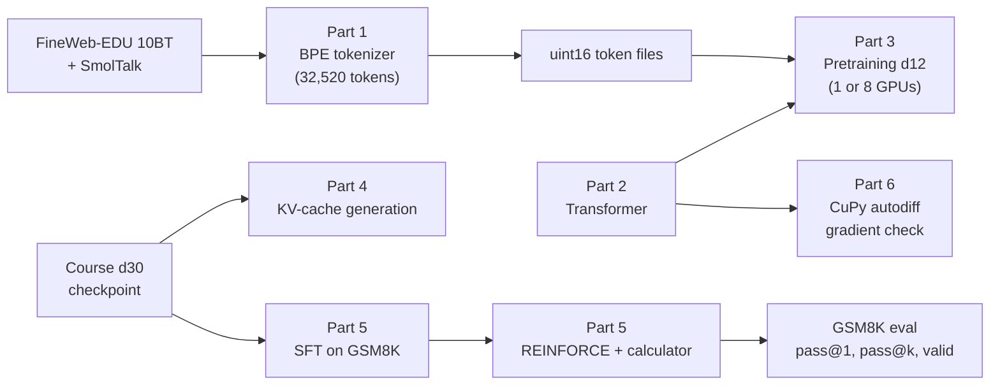

# Large Language Model from Scratch

A from-scratch implementation of the full language-model stack: a byte-level BPE tokenizer, a decoder-only Transformer, single- and multi-GPU pretraining, KV-cache inference, supervised fine-tuning (SFT) and REINFORCE on GSM8K with a calculator tool, and a reverse-mode automatic differentiation engine that runs on CuPy.

This repository is an individual sub-project of a Fall 2026 Carnegie Mellon University course. The assignment scaffolding, grader test files, and course data come from the public [`zkolter/llm_speedrun`](https://github.com/zkolter/llm_speedrun) repository. The model, optimizer, and training loops use tensor primitives, not `torch.nn` modules or `torch.optim`. Part 6 replaces PyTorch autograd with its own engine.

> **Training status.** The model was trained, but the trained weights and training logs are not hosted in this repository.

---

## Contents

1. [Objectives](#1-objectives)
2. [Repository structure](#2-repository-structure)
3. [Pipeline](#3-pipeline)
4. [Model architecture](#4-model-architecture)
5. [Tokenizer (Part 1)](#5-tokenizer-part-1)
6. [Pretraining (Part 3)](#6-pretraining-part-3)
7. [KV-cache inference (Part 4)](#7-kv-cache-inference-part-4)
8. [SFT, tool use, REINFORCE, and GSM8K evaluation (Part 5)](#8-sft-tool-use-reinforce-and-gsm8k-evaluation-part-5)
9. [Automatic differentiation on CuPy (Part 6)](#9-automatic-differentiation-on-cupy-part-6)
10. [Reproducibility](#10-reproducibility)
11. [Future work](#11-future-work)

---

## 1. Objectives

- Implement every model component from tensor primitives and verify each one against the course grader.
- Train a compute-budgeted language model with a data-parallel loop that uses raw NCCL collectives.
- Make autoregressive generation efficient with a preallocated key–value (KV) cache.
- Post-train a pretrained model for math word problems: SFT first, then policy-gradient RL with a verifiable reward.
- Rebuild backpropagation without PyTorch and check its gradients against PyTorch.

## 2. Repository structure

Each part is self-contained. A part's notebook holds the implementation. The `*_tests.py` file beside it holds the course's local and submission tests, which the notebook imports by name.

```
.
├── part0_mugrade_setup/              Grading-harness warm-up (sieve, polynomial algebra)
│   ├── part0_mugrade_setup.ipynb
│   └── part0_mugrade_tests.py
├── part1_bpe_tokenizer/              Byte-level BPE: train, encode, decode, save; data download and pretokenization
│   ├── part1_bpe_tokenizer.ipynb
│   └── part1_tokenizer_tests.py
├── part2_transformer_architecture/   Embedding, RoPE, QK-norm attention, MLP, Transformer block
│   ├── part2_transformer_architecture.ipynb
│   └── part2_llm_arch_tests.py
├── part3_pretraining/                Cross-entropy, AdamW, LR schedule, single-GPU and NCCL data-parallel training
│   ├── part3_pretraining.ipynb
│   └── part3_llm_training_tests.py
├── part4_kv_cache_inference/         Position-offset RoPE, KV cache, temperature sampling with EOS
│   ├── part4_kv_cache_inference.ipynb
│   └── part4_inference_tests.py
├── part5_sft_reinforce_gsm8k/        Tool-calling generation, masked SFT, REINFORCE, GSM8K pass@k
│   ├── part5_sft_reinforce_gsm8k.ipynb
│   └── part5_rl_tests.py
├── part6_cupy_autodiff/              Reverse-mode autodiff on CuPy; LLM rebuilt on it; gradient check vs PyTorch
│   ├── part6_cupy_autodiff.ipynb
│   └── part6_autodiff_tests.py
├── tests/test_notebooks.py           CPU-only repository tests (no GPU, data, or Mugrade account)
├── requirements.txt
├── pytest.ini
├── .env.example
└── .gitignore
```

The directories `part0`–`part6` map one-to-one to the original assignment folders `A0`–`A6`.

## 3. Pipeline



Parts 4 and 5 use the course-provided `d30` checkpoint, not a model trained in Part 3. Part 6 checks gradients on the course-provided `d12` checkpoint.

## 4. Model architecture

Part 2 defines the model. Later parts copy it and extend it.

```
tokens ─► E[tokens] ─► RMSNorm ─► Block × L ─► RMSNorm ─► W_out ─► logits

Block(x):  h = x + MHA(RMSNorm(x))      MHA = RoPE → QK-norm → causal softmax attention
           y = h + W₂·SiLU(W₁·RMSNorm(h))
```

### 4.1 Components

| Component | Definition in code | Notes |
|---|---|---|
| RMSNorm | $\mathrm{RMSNorm}(x) = x / \sqrt{\tfrac{1}{d}\sum_i x_i^2}$ | No learnable gain and no $\epsilon$. Computed in float32, then cast back. |
| SiLU | $\mathrm{SiLU}(x) = x\,\sigma(x)$ | Implemented as `x / (1 + exp(-x))`. |
| MLP | $W_2\,\mathrm{SiLU}(W_1 x)$, $W_1 \in \mathbb{R}^{d \times 4d}$ | Not gated (not SwiGLU). No biases anywhere in the model. |
| Attention | $\mathrm{softmax}\!\left(QK^\top/\sqrt{d_h} + M\right)V$, with $M_{ij} = 0$ if $j \le i$, else $-\infty$ | Multi-head; $H = d / d_h$ heads. |
| RoPE | see below | Interleaved pairs $(x_{2i}, x_{2i+1})$; base $\theta = 10^4$. |
| QK-norm | $\hat q = \mathrm{RMSNorm}(\mathrm{RoPE}(q))$, same for $k$ | Applied after RoPE. |
| Embedding / output | Separate matrices $E \in \mathbb{R}^{V\times d}$, $W_{\text{out}} \in \mathbb{R}^{d\times V}$ | Untied. |

**RoPE.** For the pair $i$ at position $p$, with $\omega_i = \theta^{-2i/d_h}$:

$$
\begin{aligned}
x'_{2i}   &= x_{2i}\cos(p\,\omega_i) - x_{2i+1}\sin(p\,\omega_i) \\
x'_{2i+1} &= x_{2i+1}\cos(p\,\omega_i) + x_{2i}\sin(p\,\omega_i)
\end{aligned}
$$

The code precomputes two tables, $w_1 = [\cos, \cos]$ and $w_2 = [-\sin, \sin]$ (interleaved), and computes $x' = w_1 \odot x + w_2 \odot \mathrm{swap\_pairs}(x)$.

**QK-norm bounds the logits.** After RMSNorm, $\lVert \hat q \rVert_2 = \lVert \hat k \rVert_2 = \sqrt{d_h}$. Therefore $|\hat q^\top \hat k| / \sqrt{d_h} \le \sqrt{d_h}$, which is about 11.3 for $d_h = 128$. The attention logits cannot grow without bound during training.

**Mixed precision.** `__init__` creates the parameters in float32. `linear` casts the weight to the activation dtype (bfloat16 in every config in this repository), so matrix multiplications run in bfloat16. The logits are cast to float32 before the loss.

**Initialization.** He-normal. $E$, $W_{\text{out}}$, the attention matrices, and $W_1$ use $\mathcal{N}(0, 2/d)$. $W_2$ uses $\mathcal{N}(0, 2/(4d))$.

### 4.2 Size

The width scales with depth: $d = 64L$, $d_h = 128$, MLP width $4d$, vocabulary $V = 32{,}768$. The parameter count is

$$
N = \underbrace{2Vd}_{E,\ W_{\text{out}}} + L\,(\underbrace{4d^2}_{Q,K,V,O} + \underbrace{8d^2}_{W_1, W_2}) = 2Vd + 12Ld^2 .
$$

| Config | $L$ | $d$ | Heads | Embedding + output | Blocks | **Total** |
|---|---|---|---|---|---|---|
| d12 (Part 3) | 12 | 768 | 6 | 50,331,648 | 84,934,656 | **135,266,304** |

The `d30` config that Parts 4 and 5 download is not in this repository, so this table does not include it.

## 5. Tokenizer (Part 1)

- **Base alphabet.** 256 byte symbols. Corpora are decoded as Latin-1, so each byte maps to one character.
- **Pre-tokenization.** Regex `\s\S+|\s+|\S+`: each word keeps its leading whitespace character. Merges never cross word boundaries.
- **Training.** Count word frequencies, drop words that occur once, then repeat: add the most frequent adjacent pair (weighted by word frequency) as a new symbol. Special-token code points are removed from training words.
- **Encoding.** Within each word, apply the learned merge with the lowest rank first, until no merge applies. Special tokens map to single code points (`chr(id)`). No merge contains them, so each one encodes to its own ID.
- **Vocabulary.** $2^{15} - 256 = 32{,}512$ byte and merge symbols, plus 8 special tokens (`<DOCUMENT>`, `<SYSTEM>`, `<USER>`, `<ASSISTANT>` and their closing tags) at IDs 32,512–32,519. Part 5 adds 11 more (`<QUESTION>`, `<THINK>`, `<TOOL>`, `<RESPONSE>`, `<ANSWER>`, closing tags, and `<MASK/>`). The model's output layer has 32,768 rows, so `decode` in Parts 5–6 skips IDs outside the vocabulary.
- **Data.** The notebook downloads FineWeb-EDU (10BT sample) and SmolTalk, shuffles documents with seed 42, and wraps them in `<DOCUMENT>…</DOCUMENT>`. The tokenizer trains on the first 40 MB of FineWeb-EDU and 10 MB of SmolTalk (`tokenizer_50M.bpe`). `pretokenize` encodes the corpora in parallel chunks and writes uint16 arrays.

## 6. Pretraining (Part 3)

### 6.1 Objective and optimizer

The loss is the mean token-level cross-entropy, computed with max-subtraction for stability:

$$
\mathcal{L} = \frac{1}{BT}\sum_{b,t}\Big(-z_{b,t,y_{b,t}} + \log\sum_j e^{z_{b,t,j}}\Big).
$$

The optimizer is Adam with decoupled weight decay (AdamW), $\beta = (0.9, 0.95)$, $\epsilon = 10^{-5}$:

$$
\begin{aligned}
m_t &= \beta_1 m_{t-1} + (1-\beta_1)\,g_t, \qquad v_t = \beta_2 v_{t-1} + (1-\beta_2)\,g_t^2,\\
\theta &\leftarrow \theta\,(1 - \eta_t\lambda) - \eta_t\,\frac{m_t/(1-\beta_1^t)}{\sqrt{v_t/(1-\beta_2^t)} + \epsilon}.
\end{aligned}
$$

### 6.2 Learning-rate schedule

Warm-up, then constant, then linear decay. Here $W = 50$ warm-up steps, $f = 0.1$ is the floor fraction, and $D = \mathrm{round}(0.4\,S)$ is the decay length for $S$ total steps:

$$
\eta(t) = \eta_{\max}\cdot
\begin{cases}
f + (1-f)\,t/W, & t < W\\
1, & W \le t \le S - D\\
(1-\rho) + \rho f,\quad \rho = \dfrac{t-(S-D)}{D}, & t > S - D
\end{cases}
$$

### 6.3 Compute budget and data

- **Token budget.** $N_{\text{tokens}} = 20 \times N$ (`token_multiple = 20`). For d12 this is 2,705,326,080 tokens.
- **Steps.** $S = N_{\text{tokens}} / (B \cdot T)$.
- **Data mix.** Each batch takes `round(0.875·B)` rows from FineWeb-EDU and `round(0.125·B)` rows from SmolTalk. Each row holds $T+1$ tokens read sequentially from the pre-shuffled uint16 files. A file wraps to offset 0 at its end.
- **Bits per byte.** $\mathrm{bpb} = \mathcal{L}\cdot B T / (n_{\text{bytes}} \ln 2)$, where $n_{\text{bytes}}$ is the length of the decoded target text.

### 6.4 Data-parallel training

`train_llm_distributed` runs one process per GPU (joblib `loky` backend) and uses `torch.cuda.nccl` directly:

1. Rank 0's initial parameters are broadcast to all ranks.
2. Each rank reads its slice of the global batch ($B/G$ rows for $G$ GPUs).
3. After `backward()`, each gradient is all-reduced and divided by $G$, which gives the global-mean gradient.
4. Every rank applies the same AdamW step, so the replicas stay identical without further synchronization.

### 6.5 Configurations in the notebook

| Config file (written by the notebook) | GPUs | $B$ (sequences) | $T$ | Tokens / step | $\eta_{\max}$ | $\lambda$ | $S$ |
|---|---|---|---|---|---|---|---|
| `config_original.d12.json` (course, 80 GB GPU) | 1 | 16 | 2048 | 32,768 | 7e-4 | 0.025 | 82,560 |
| `config.d12.json` (reduced, single GPU) | 1 | 4 | 1024 | 4,096 | 1.5e-4 | 0.025 | 660,480 |
| `config.d12.8gpu.json` (course, 8 GPUs) | 8 | 128 | 2048 | 262,144 | 1e-3 | 0.1 | 10,320 |

With $B = 4$, Python's `round` gives 4 FineWeb-EDU rows and 0 SmolTalk rows, so the reduced config trains on FineWeb-EDU only.

## 7. KV-cache inference (Part 4)

### 7.1 Design

- **Cache layout.** One preallocated pair of tensors per layer: `k`, `v` of shape $(B, H, T_{\max}, d_h)$ with $T_{\max} = T_{\text{prompt}} + n_{\text{new}}$. The cache stores keys after RoPE and QK-norm.
- **Position offset.** A forward call with offset `pos` processes $\ell$ new tokens. It uses the RoPE rows $[\text{pos}, \text{pos}+\ell)$ and writes $k, v$ to cache slots $[\text{pos}, \text{pos}+\ell)$. It attends over slots $[0, \text{pos}+\ell)$ with the mask slice `mask[pos:pos+ℓ, :pos+ℓ]`.
- **Prefill, then decode.** One call processes the whole prompt at `pos = 0`. Each later call processes one token.
- **Sampling.** $p = \mathrm{softmax}(z_{\text{last}}/\tau)$, then one multinomial draw per row. Generation stops after `max_tokens` new tokens, or earlier when every row has produced the EOS token.

### 7.2 Cost

For layer width $d$ and context length $t$, one decode step costs:

| | Projections and MLP | Attention |
|---|---|---|
| Without cache (recompute the prefix) | $O(t\,d^2)$ | $O(t^2 d)$ |
| With cache | $O(d^2)$ | $O(t\,d)$ |

Cache memory is $2 \cdot L \cdot B \cdot T_{\max} \cdot d \cdot s$ bytes for $s$ bytes per element. For d12 in bfloat16 with $B = 1$ and $T_{\max} = 2048$, this is 75,497,472 bytes (about 75.5 MB).

## 8. SFT, tool use, REINFORCE, and GSM8K evaluation (Part 5)

### 8.1 Data format

GSM8K calculator annotations `<<48/2=24>>` become tool calls. Each example is encoded as

```
<DOCUMENT><QUESTION>…</QUESTION><THINK>… <TOOL>48/2</TOOL><RESPONSE>24</RESPONSE> …</THINK><ANSWER>72</ANSWER></DOCUMENT>
```

and right-padded with `<MASK/>` to 513 tokens. The course provides the encoded `gsm8k_{train,test}.json`. The notebook also contains the code that rebuilds them.

### 8.2 Tool-calling generation

`generate` fills a `<MASK/>`-padded buffer one position at a time and uses the KV cache. A position is sampled only if it still holds `<MASK/>`. When a row samples `</TOOL>`, the code:

1. decodes the tokens after the last `<TOOL>`,
2. evaluates them with `tool_eval`, a restricted arithmetic evaluator (numbers, `+ - * / // % **`, parentheses; result rounded to 2 decimals),
3. writes the tokens of `<RESPONSE>value</RESPONSE>` into the next positions, if they fit in the buffer.

These forced tokens then pass through the model like any other token, so they enter the cache.

### 8.3 Supervised fine-tuning

The masked cross-entropy excludes `<MASK/>` targets from both the sum and the count. Optional per-sequence weights $w_i$ scale the terms but not the normalizer:

$$
\mathcal{L}_{\text{SFT}}(w) = \frac{1}{|\mathcal{M}|}\sum_{(i,t)\in\mathcal{M}} w_i\big(-\log \pi_\theta(y_{i,t}\mid y_{i,<t})\big),
\qquad \mathcal{M} = \{(i,t) : y_{i,t} \ne \texttt{<MASK/>}\}.
$$

Each sequence is cyclically shifted by a random amount. The shift moves part of the trailing padding to the front, so the model learns to ignore leading `<MASK/>` tokens. Batched evaluation relies on this, because it left-pads prompts. The optimizer is Adam with a constant learning rate and no weight decay. Gradients are all-reduced with NCCL as in Part 3.

### 8.4 REINFORCE with a group baseline

For each batch of $n$ problems, every rank does the following:

1. Adds the SFT loss on the reference solutions, weighted by `sft_loss_weight`.
2. Samples $k$ completions per problem with tool use.
3. Computes the reward $r_{ij} = \mathbb{1}[\text{correct}_{ij}] + 0.05\cdot\mathbb{1}[\text{well-formatted}_{ij}]$.
4. Normalizes within each problem's group of $k$ samples:
   $\hat A_{ij} = \dfrac{r_{ij} - \operatorname{mean}_j r_{ij}}{\operatorname{std}_j r_{ij} + 10^{-5}}$.
5. Minimizes $\mathcal{L}_{\text{RL}} = \mathcal{L}_{\text{SFT}}(w = \hat A)$ on the sampled sequences. Its gradient is the REINFORCE estimator $-\frac{1}{|\mathcal{M}|}\sum_{i,j}\hat A_{ij}\sum_t \nabla_\theta \log \pi_\theta(y_{ij,t}\mid y_{ij,<t})$.
6. Accumulates both gradients, all-reduces them, and takes one Adam step.

The update is on-policy and single-step. It has no importance ratio, no clipping, and no KL penalty. Prompt tokens are identical within a group and $\sum_j \hat A_{ij} = 0$, so their loss terms cancel. Tool-response tokens are not sampled by the policy, but they stay in the loss.

### 8.5 Evaluation

The prompt is the encoded example up to and including `<THINK>`, repeated $k$ times and left-padded with `<MASK/>`. Generation stops at `</ANSWER>`. `extract_answer` parses the integer in the first `<ANSWER>…</ANSWER>`. For $N$ problems and correctness $c_{ij}$:

$$
\text{pass@1} = \frac{1}{Nk}\sum_{i,j} c_{ij}, \qquad
\text{pass@}k = \frac{1}{N}\sum_i \max_j c_{ij}, \qquad
\text{valid} = \frac{1}{Nk}\sum_{i,j} \mathbb{1}[\text{answer parsed}_{ij}].
$$

Here pass@1 is the mean over all $k$ samples, which is an unbiased estimate. `eval_dataset` splits problems across GPUs and normalizes by the global count, so the per-rank results sum to the final metrics. The hyperparameters ($k$, learning rate, epochs, batch size, `sft_loss_weight`) come from the downloaded `config.d30.{sft,rl,eval}.json` files, which are not in this repository.

## 9. Automatic differentiation on CuPy (Part 6)

### 9.1 Engine

`Tensor` stores `value`, `grad`, `parents`, a vector–Jacobian product (`vjp`) callback, and `num_children`. `Tensor.build(forward, vjp, *args)` runs the forward function on raw arrays. If any argument requires a gradient, it records the node and increments `num_children` on each `Tensor` argument. Plain arrays (for example, integer targets) are allowed as arguments.

`backward()` uses reference counting instead of an explicit topological sort. A node adds its VJP outputs to its parents' gradients and decrements their counters. A parent recurses only when its counter reaches zero, that is, after all of its consumers have contributed. Each node's VJP therefore runs exactly once, with its complete upstream gradient.

| Operation | Forward | VJP (upstream $\bar g$) |
|---|---|---|
| `+`, `*` | $x+y$, $x\odot y$ | $(\bar g, \bar g)$, $(\bar g\odot y, \bar g\odot x)$ |
| `@` | $XY$ | $(\bar G Y^\top, X^\top \bar G)$, summed over broadcast batch axes |
| `[idx]` | $x[\text{idx}]$ | scatter-add into zeros (`np.add.at` for integer-array indices) |
| `transpose`, `reshape`, `flip`, `to` | view or cast | inverse view or cast |
| `softmax` | $s$ | $s\odot(\bar g - \textstyle\sum s\odot \bar g)$ |
| `cross_entropy_loss` | $\operatorname{mean}(-\log p_y)$ | $\bar g\,(p - \mathrm{onehot}(y))/N$ |
| `silu` | $x\sigma(x)$ | $\bar g\,\sigma(x)\,(1 + x(1-\sigma(x)))$ |
| `rms_norm` | $x/r$, $r = \sqrt{\overline{x^2}}$ | $\big(\bar g - x\,\overline{\bar g\odot x}/r^2\big)/r$ (float32) |
| `self_attn` (fused) | $A V$, $A = \mathrm{softmax}(QK^\top/\sqrt{d_h}+M)$ | $dV = A^\top\bar G$; $dS = A\odot(\bar G V^\top - \mathrm{rowsum}(A\odot \bar G V^\top))$; $dQ = dS\,K/\sqrt{d_h}$; $dK = dS^\top Q/\sqrt{d_h}$ |

The fused `self_attn` node recomputes $A$ in its VJP instead of storing it. This saves one $(B, H, T, T)$ tensor per layer.

### 9.2 Role of CuPy

The cell imports CuPy as `np`. CuPy mirrors the NumPy API on the GPU, so the same engine code runs on CPU (NumPy) for the unit tests and on the GPU (CuPy) for the full model. Every forward function and VJP in the engine is written in CuPy array operations: matrix products, elementwise math, reductions, `take_along_axis`/`put_along_axis` for the loss, and `add.at` scatter-adds for embedding gradients. These operations execute as CUDA kernels on the GPU. Matrix products use cuBLAS. All arrays, including the RoPE tables and the causal mask, stay in GPU memory. The CuPy model uses PyTorch only to load the reference checkpoint and gradients.

### 9.3 LLM on the engine and gradient check

The notebook rebuilds the Part 4 LLM on `Tensor` and builds the RoPE tables and mask with CuPy only. The last cell loads the course `d12` checkpoint and computes the loss on the first 4 sequences of FineWeb-EDU. It then prints, for each parameter, $\lVert \nabla^{\text{CuPy}} - \nabla^{\text{PyTorch}} \rVert_2$ against `grads.pt`, which an earlier cell computes with PyTorch. CuPy has no bfloat16, so the CuPy model runs in float32. The notebook has no saved output for this check.

## 10. Reproducibility

### 10.1 Environment

- Python **3.12 or newer**. Some cells use PEP 701 f-strings.
- Parts 0–2 and the repository tests run on CPU.
- Parts 3–5 need an NVIDIA GPU. The distributed cells need several GPUs with NCCL. Part 6 needs CuPy for your CUDA version.

```bash
python3.12 -m venv .venv && source .venv/bin/activate
pip install -r requirements.txt
pip install cupy-cuda12x        # Part 6 only; match your CUDA version
cp .env.example .env             # add MUGRADE_KEY; HF_TOKEN and WANDB_API_KEY are optional
pytest                           # CPU-only repository tests
```

### 10.2 Credentials

The notebooks read `MUGRADE_KEY` from the environment and load a `.env` file if `python-dotenv` is installed. `huggingface_hub` reads `HF_TOKEN`, and `wandb` reads `WANDB_API_KEY`. `.env` is git-ignored. Do not put credentials in notebooks.

### 10.3 Running a part

Start Jupyter (or upload the notebook to Colab) and run the notebook **from its own directory**. Cells download files and write configs to the working directory. The first code cell installs `mugrade` and fetches the part's test file if it is missing. Cells decorated with `@mugrade.submit_tests` send answers to the Mugrade server. To run only the local tests, change them to `@mugrade.local_tests`.

### 10.4 External artifacts

The notebooks download these files from the Hugging Face dataset repository `zkolter/llm_speedrun`. They are git-ignored.

| Files | Used by |
|---|---|
| `tokenizer_50M.bpe` | Parts 3, 4, 5 |
| `fineweb-edu-10BT.shuffle.bin`, `smoltalk.shuffle.bin` | Part 3 (Part 6 uses the FineWeb file) |
| `llm.d30.pt`, `config.d30.json` | Parts 4, 5 |
| `tokenizer_50M_rl.bpe`, `config.d30.{sft,rl,eval}.json`, `gsm8k_{train,test}.json` | Part 5 |
| `config.d12.json`, `llm.d12.pt` | Part 6 |

Part 1 can rebuild the tokenizer and token files from the raw datasets. This needs a large machine: `pretokenize` uses 128 worker processes by default.

### 10.5 Determinism

Dataset shuffling and the GSM8K file order use seed 42. Parameter initialization, SFT shifts, and sampling do not set a seed, so runs are not bit-reproducible.

## 11. Future work

- Host the trained weights, and publish the loss, bpb, and GSM8K pass@1/pass@k/valid results for the base, SFT, and RL models.
- Move the shared tokenizer and model code into a package that the notebooks import.
- Add PPO-style ratio clipping or a KL penalty to the SFT model, and remove non-policy tokens from the RL loss.
- Run `pytest` in continuous integration.
